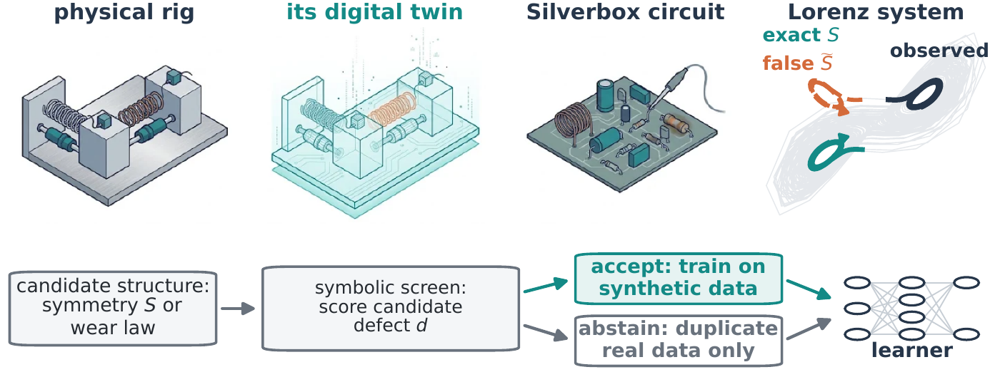

# When Do Synthetic Trajectories Count as Evidence?

### Information, Utility, and Verification in Digital Twins

**Prasad Cheema · Mahito Sugiyama**  
National Institute of Informatics, Tokyo · L4DC 2027 submission

[**Read the paper**](paper.pdf) · [**Reproduce experiments**](docs/REPRODUCIBILITY.md) · [**External benchmark inputs**](docs/DATA_SOURCES.md)



A digital twin can generate unlimited trajectories, but **more synthetic data are not necessarily more evidence about the physical system**. This work separates three questions that are often conflated:

1. **What information is present?** Self-generated labels cannot provide independent physical evidence. Treating them as independent observations can nevertheless produce overconfident uncertainty estimates.
2. **When does a learner benefit?** The value of a synthetic trajectory depends on the learner and the deployment objective, not just on whether the simulator is physically correct. Even a biased generator can help a misspecified learner at an appropriate exposure.
3. **What can be verified before use?** We examine symbolic and geometric consistency checks, including their limits when training data cover only part of the state space. A verifier can be most confident where new structural information is least valuable to that verifier.

The study combines finite-sample analysis and experiments on Lorenz and Duffing systems, a predictive-maintenance digital twin, and four nonlinear system-identification benchmarks. It studies **when to trust and use synthetic trajectories**, rather than introducing a new augmentation algorithm.

## Repository layout

```text
.
├── paper.pdf                  # Manuscript, references, and supplement
├── main.tex                   # Overleaf/pdfLaTeX entry point
├── supplement.tex             # Contiguous supplementary material
├── refs.bib                   # References
├── *.cls, *.sty, main.bbl     # Bundled LaTeX dependencies
├── figures/                   # Paper figures and source illustrations
├── code/                      # Experiments, figures, and mathematical checks
├── harness/                   # Frozen learner and simulation protocols
├── data/                      # Archived experiment-level results (read-only)
├── scripts/                   # Safe reproduction and verification launchers
├── external_data/             # User-supplied benchmark recordings (not bundled)
└── docs/                      # Reproducibility notes and data sources
```

## Quick start

Install Python 3.11–3.13 and the listed dependencies:

```bash
python -m pip install -r requirements.txt
python scripts/check_release.py --files
python scripts/check_release.py --math
python scripts/reproduce.py --list
```

To rerun one of the supported simulated experiments:

```bash
python scripts/reproduce.py --group lorenz
python scripts/reproduce.py --group duffing
```

New outputs are written to `.runs/`; the original archived `data/` files are **never overwritten**. Consult [the reproducibility guide](docs/REPRODUCIBILITY.md) for the other experimental groups and the exact scope of verification.

## Compiling the paper

The root directory is a self-contained Overleaf project. Upload a ZIP of the repository to Overleaf, choose `main.tex` as the main document, and compile using **pdfLaTeX**. A clean local build has been verified. The LaTeX source includes the bibliography and all graphics used in the manuscript.

## Reproducibility and data availability

The repository includes the archived seed-level outputs used by the paper and executable code for many studies. It **does not yet reproduce every published result from original raw inputs**. In particular, original recordings for Silverbox, EMPS, Wiener–Hammerstein and cascaded tanks are not distributed here; some earlier experiment generators are also unavailable. Their requirements and original sources are documented in [Data sources](docs/DATA_SOURCES.md) and [Reproducibility](docs/REPRODUCIBILITY.md).

The manuscript's disclosure about AI-generated illustrative artwork remains in the manuscript. Those illustrations should not be mistaken for experimental evidence.

## Attribution

Authors: Prasad Cheema and Mahito Sugiyama, National Institute of Informatics, Tokyo. This repository does not currently declare an open-source license. External datasets remain subject to their providers' terms; please seek permission before reusing or redistributing materials beyond the applicable rights.
